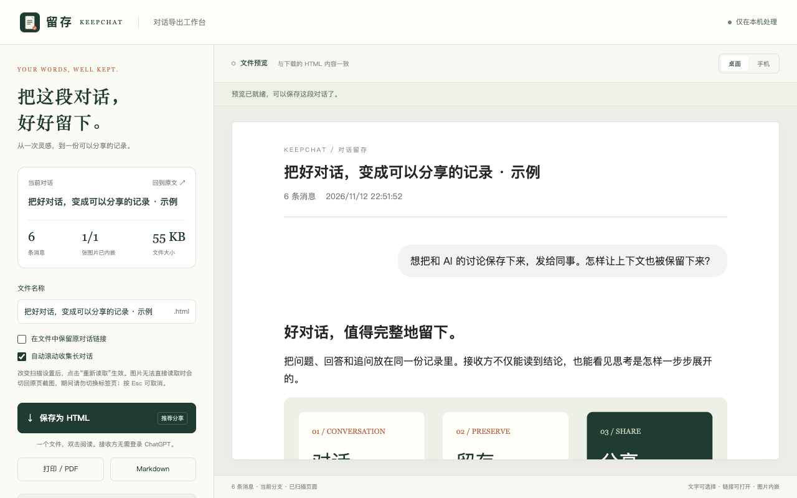

# KeepChat · 留存

[Website & live example](https://www.tokrace.com/en/tools/keepchat) · [Download the fictional example](https://www.tokrace.com/keepchat/moon-ramen.html)

[简体中文](README.md) · English · [Download](https://github.com/twonly/keepchat/releases/latest) · [Report an issue](https://github.com/twonly/keepchat/issues)

Save a rendered ChatGPT conversation as a self-contained HTML file for offline reading and sharing. KeepChat copies visible content and styles; it does not rewrite answers with AI. The extension UI is currently in Simplified Chinese and can preserve conversations in other languages.



## Install

Requires Chrome 120+ or Chromium-based Edge.

1. Download `keepchat-1.0.4.zip` from [Releases](https://github.com/twonly/keepchat/releases/latest) and extract it into a permanent folder.
2. Open `chrome://extensions` (or `edge://extensions`), enable **Developer mode**, and select **Load unpacked**.
3. Choose the extracted folder containing `manifest.json` and pin KeepChat to the toolbar.

You can also load this repository directly. No build, API key or account with KeepChat is required. To update an unpacked installation, replace its files, reload the extension, refresh ChatGPT and reopen the export preview.

## Export

Open a completed ChatGPT conversation or shared page (`/c/`, `/share/`, `/s/t_…`; legacy `chat.openai.com` is also supported). Click KeepChat, then **打开导出预览** (Open export preview).

Review the desktop or mobile preview, rename the file if needed, and choose **保存为 HTML** (Save HTML). Recipients can open this single file in a browser without the extension or a ChatGPT login. Some messaging apps require downloading the attachment before opening it in a browser.

- **HTML:** selectable text, layout, tables, code, readable formulas and embedded images.
- **Markdown:** editable text, code and tables; visual fidelity and embedded image support depend on the reader.
- **PDF:** use **打印 / PDF**, then the browser's **Save as PDF**. Printing changes pagination.

Long conversations are collected by scrolling. Keep the source tab open and do not change its conversation while reading. When an image cannot be fetched, KeepChat can activate the source tab and crop a screenshot of the image; keep that tab active until capture finishes. Press Esc to cancel.

This is a static snapshot of the currently rendered branch, not a complete backend backup or a promise of pixel-perfect reproduction. Other branches, unloaded content, attachment files, complex SVG effects and interactive media may not be preserved. Missing resources and incomplete scans are reported when detected. Screenshots preserve displayed resolution rather than recovering original image files.

Limits: 8 MiB per resource, 12 MiB total embedded resources, 48 MiB transfer payload; scanning stops after 90 seconds / 240 steps and a capture job after 180 seconds. A screenshot is limited to 16 million pixels / 64 tiles.

## Privacy

No analytics, developer server, remote executable code or conversation uploads. Preview data stays in the extension's local IndexedDB; records older than 24 hours are removed on the next cache access. You can clear a preview immediately. Downloaded files remain under your control.

The extension requests original image, font and stylesheet URLs to embed resources. Page-origin requests may use the page's existing login context; extension-side resource requests omit credentials. Full viewport screenshots are cropped in memory and are not persisted or uploaded. Only image crops can enter the preview and export.

Permissions: `activeTab`, `scripting`, `downloads`, and resource access to `images.openai.com`, `www.google.com` and `*.gstatic.com` (Google endpoints are restricted to favicon paths in code). No always-on content scripts or all-sites access. See the bilingual [privacy policy](PRIVACY.md) for details.

Exported HTML removes source scripts and unsafe attributes, applies a strict content security policy, and is previewed in a sandboxed iframe. The conversation itself can still contain private information: review it before sharing. Hiding the source link does not redact personal information in the conversation.

## Development

Runtime: plain JavaScript and CSS, Manifest V3, no runtime dependencies. Development tests use Playwright.

```sh
npm ci
npx playwright install chromium
npm run check
npm test
npm run test:browser
npm run package
```

Packaging uses the system `zip` command on macOS/Linux. `dist/keepchat-1.0.4.zip` contains only extension code, icons, documentation and the license. Tests use fictional fixtures; generated output, local caches and private conversations are excluded from Git and packages.

For contributions, include a public minimal reproduction and run the relevant checks. Never attach private chats, tokens, cookies or account screenshots to public issues. See [release notes](CHANGELOG.md).

## License

[MIT](LICENSE). Independently developed; not affiliated with or endorsed by OpenAI.
