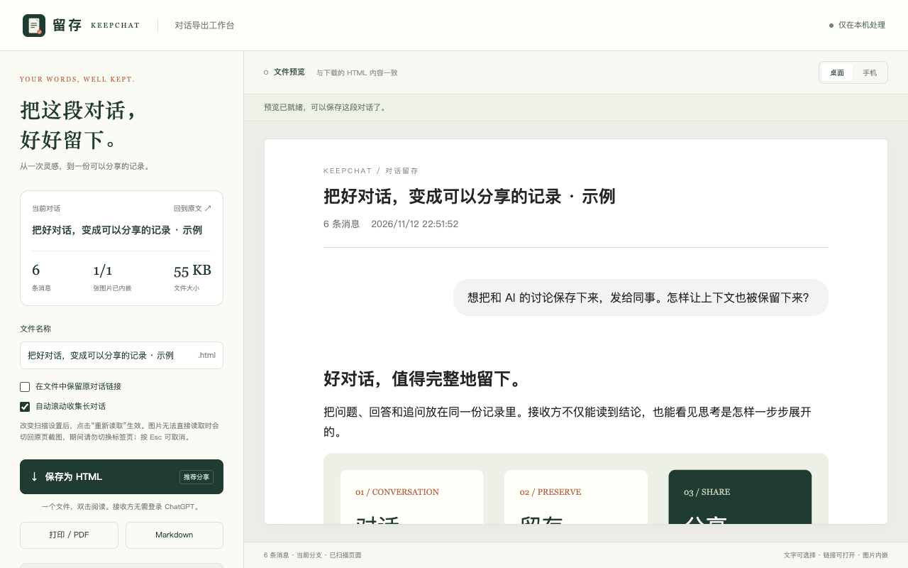

# 留存 · KeepChat

简体中文 · [English](README.en.md) · [下载最新版本](https://github.com/twonly/keepchat/releases/latest) · [问题反馈](https://github.com/twonly/keepchat/issues)

把一段 ChatGPT 对话，保存成可以离线阅读、直接发送给别人的 HTML 文件。插件使用页面快照保留已呈现的文字与排版，不调用 AI 重新生成正文。



## 安装（Chrome 120+ / Chromium Edge）

1. 从 [GitHub Releases](https://github.com/twonly/keepchat/releases/latest) 下载 `keepchat-1.0.4.zip`，解压到一个固定文件夹。
2. 打开 `chrome://extensions`（Edge 使用 `edge://extensions`）。
3. 开启右上角 **开发者模式**，点击 **加载已解压的扩展程序**。
4. 选择解压后包含 `manifest.json` 的文件夹。
5. 在浏览器的扩展菜单中，将 **留存 · ChatGPT 对话导出** 固定到工具栏。

也可以直接加载本项目目录；无需运行 npm、开发服务器或申请 API Key。旧版使用者需要替换原扩展文件夹中的文件，或选择新版解压文件夹重新加载；在扩展管理页点“重新加载”后，刷新 ChatGPT 网页并关闭旧导出页，再从对话页打开插件。弹窗右上角显示实际安装版本，本版为 **1.0.4**。

## 使用

1. 在 Chrome 中打开目标对话，等待回复生成结束。支持普通 `/c/` 对话、`/share/` 分享页、`/s/t_…` 分享页和旧版 `chat.openai.com`。
2. 点击留存图标 → **打开导出预览**。
3. 扩展在独立标签页中读取对话。保留原标签页，不要在读取期间切换原页的对话或发送新消息。
4. 图片读取失败时，会自动切回原对话进行截图，请暂时不要切换标签页；可按 **Esc** 取消。完成后返回导出工作台。
5. 在桌面 / 手机预览中核对消息、图片和保存说明。可改文件名、取消保存来源链接；默认自动滚动收集长对话。
6. 点击 **保存为 HTML**，选择位置。将得到的单个 `.html` 文件直接发送给他人。

接收方无需插件或 ChatGPT 账户，用浏览器打开 HTML 即可离线阅读。部分聊天应用不直接预览 HTML，需要先下载，再选择浏览器打开。外部链接只有主动点击时才会打开对应网站。

**PDF：**点击“打印 / PDF”，在 Chrome 的打印对话框选择“另存为 PDF”。需要背景色时开启“背景图形”。打印会重新分页。

**Markdown：**适合继续编辑，保留文本结构、代码与表格，不保证与原页视觉相同。图片使用内嵌数据，一些 Markdown 阅读器可能不支持。

## 保留范围

| 内容 | 保存行为 |
| --- | --- |
| 当前分支的消息 | 按页面顺序收集，保留原文；扫描过程中出现的延迟加载消息也会收集 |
| 排版 | 从原页面提取计算后的样式：颜色、字重、间距、气泡、表格、代码高亮等 |
| 公式 | 保留已呈现的 MathML / KaTeX / SVG 与可读取字体，字体失败时提示 |
| 图片 | 优先保存原始图片；跨域失败时通过扩展读取，仍失败则自动裁取页面截图；截图会明确标注 |
| 图表 | 保存静态 HTML/CSS 图示、基础 SVG、可读取 Canvas 的图片快照 |
| 引用与链接 | 普通链接保留，弹层和动态工具不再运行 |
| 附件 | 保留卡片和可用链接；附件原文件需另行下载 |
| 视频、音频、嵌入式应用 | 保存占位说明，需回到原页使用 |
| 折叠区域 | 保持已加载的折叠结构；未加载的内容请先展开再读取 |
| 侧边栏、输入框、账户信息 | 不属于导出范围 |

“原样”指当前页面已经呈现的静态内容快照，不是 ChatGPT 后端数据的完整备份，也不承诺逐像素一致。其他分支、尚未加载的数据、页面未显示的图片、复杂 SVG 效果和动态交互无法保证完整复现。插件会显示可检测到的缺失；“已扫描页面首尾”不等于验证了后端消息总数。

截图仅保存裁出的图片区域；超过一屏时滚动分段拼接。完整屏幕截图只在内存中短暂用于裁剪，不写入文件或缓存。图片本身未加载、被遮挡、截图时切换了对话 / 标签页等情况会报告失败。截图保留页面显示效果，不能恢复原图分辨率或动图动画。每张截图最多 1600 万像素 / 64 段，仍受资源大小上限约束。

## 体验与可靠性

- 先预览再保存，读取过程不依赖弹窗保持打开。
- 兼容普通对话新版消息容器、纯图片回复、分享页正文标记和多个主区域，排除隐藏页面与侧边栏；保留消息角色与思考摘要，按消息 ID 去重，避免页面重绘时重复收集。按正文结构识别时提示核对范围。
- 初次识别最多等待正文 5 秒，连接超过 12 秒会明确报错；失败按钮不会持续显示等待光标。
- 手机预览保留可读的表格列宽；宽表格在表格内左右滚动，修正桌面表格边距在窄屏造成的挤字。已有预览缓存也会使用新版排版。
- 显示真实的消息数、已内嵌图片数、文件大小和读取时间。
- 支持取消、重试，结束后恢复原页滚动位置。
- 回复正在生成或原页已切换对话时停止读取，避免混合不同对话。
- 每次导出使用独立预览 ID，多份预览不会互相覆盖。
- 在本机缓存预览，刷新后可恢复；超过 24 小时的缓存会在下次访问缓存时清理，也可点击“清除本地预览”。
- 下载调用浏览器的另存为对话框；跟踪完成 / 中断状态，同名文件不静默覆盖。
- 可用键盘操作，状态变化提供无障碍播报，支持减少动画偏好。

为避免浏览器内存和消息大小限制，单资源上限 8 MiB，内嵌资源合计上限 12 MiB，传输包上限 48 MiB。长对话扫描最多 90 秒或 240 步，整个读取任务最多 180 秒。达到扫描限制时明确提示可能不完整，资源过大时显示缺失说明。

## 隐私与权限

使用 `activeTab`、`scripting` 和 `downloads`，以及 `images.openai.com`、`www.google.com`、`*.gstatic.com` 的资源访问权限。Google 权限仅用于读取网站图标端点，扩展请求不携带登录凭据。没有网站常驻内容脚本、全站访问权限、分析统计或云上传。只在用户点击插件后读取目标页。同源图片 / 字体 / 样式请求沿用页面访问权限。

输出 HTML 不含原页 JavaScript，设置严格内容安全策略；移除脚本、事件处理器、危险 URL 和无关属性。预览在禁用脚本的 sandbox iframe 中展示。下载文件仍可能含对话自身的私人信息，请在分享前核对内容。

参见 [隐私说明](PRIVACY.md)。权限实现参考 Chrome 官方文档：[activeTab](https://developer.chrome.com/docs/extensions/develop/concepts/activeTab)、[scripting](https://developer.chrome.com/docs/extensions/reference/api/scripting)、[downloads](https://developer.chrome.com/docs/extensions/reference/api/downloads)、[跨域请求](https://developer.chrome.com/docs/extensions/develop/concepts/network-requests)。

## 开发与验证

运行时代码为原生 JavaScript / CSS，无运行时依赖、构建步骤或远程代码。Playwright 仅用于开发检查。

```sh
npm ci
npx playwright install chromium
npm run check
npm test
npm run test:browser
npm run package
```

- `src/content.js`：普通对话与新版分享页适配、长对话扫描、样式复制、资源内嵌和内容清理。
- `src/assets.js`：限定来源的跨域图片读取与裁剪截图。
- `src/archive.js`：HTML / Markdown 生成、文件名和 URL 校验。
- `src/popup.*`：当前对话识别和导出入口。
- `src/export.*`：预览工作台、下载、打印、异常状态。
- `src/store.js`：独立预览缓存与过期清理。
- `tests/browser.mjs`：隔离的 Chrome 中加载真实插件，通过 `Extensions.triggerAction` 验证 activeTab 授权和完整下载流程；测试使用本地构造的页面，不读取真实账户。
- `tests/tables.mjs`：桌面表格容器、普通表格、合并单元格，以及 320 / 390 / 430px 窄屏的列宽、对齐和横向滚动回归。
- `tests/detection.mjs`：普通对话新版结构、页面重绘去重、角色与思考摘要、纯图片回复、长链接换行及弹窗状态回归。
- `tests/images.mjs`：图片读取、截图回退、裁剪与取消回归。

测试使用虚构数据，输出位于被 Git 忽略的 `output/`。打包只包含 `manifest.json`、`src/`、`icons/`、许可证和说明，不包含测试数据、真实对话、缓存或 node_modules。打包脚本调用系统 `zip`，适用于 macOS / Linux。

## 反馈、贡献与许可

欢迎通过 [Issues](https://github.com/twonly/keepchat/issues) 报告问题或提交 Pull Request。请提供浏览器 / 插件版本、链接类型和可公开的最小复现，勿上传私人对话、Cookie、令牌或账户截图。修改后运行上面的检查；涉及页面结构、图片或排版时，同时运行浏览器回归测试。

本项目使用 [MIT 许可证](LICENSE)。本项目独立开发，不隶属于 OpenAI，也不是 OpenAI 官方产品。当前插件界面为简体中文，可保存其他语言的对话。
